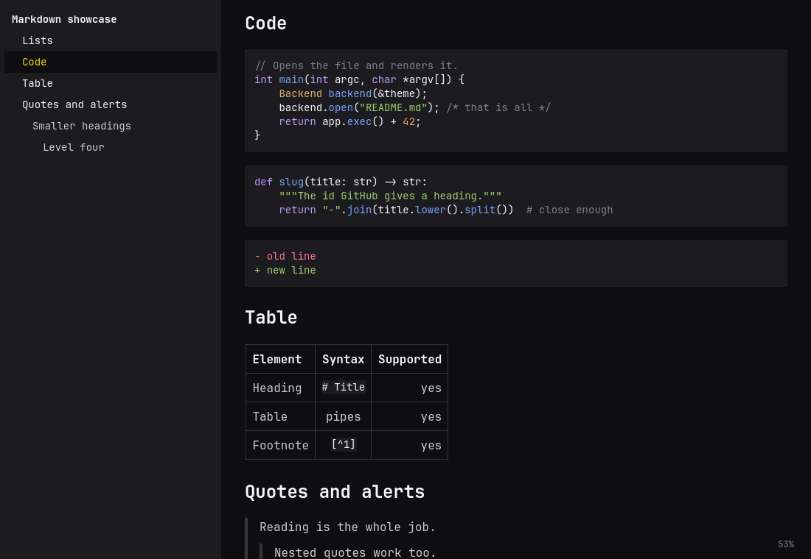

# mbingjustread-md



A Markdown reader, the way a PDF reader is a PDF reader. It opens a `.md`
file and shows it, accurately and fast. It does not edit, and it never
writes to the file it shows.

- **Accurate.** Parsing is done by [md4c](https://github.com/mity/md4c), which
  follows the CommonMark specification, with the GitHub extensions on top:
  tables, task lists, strikethrough, autolinks, footnotes, and alerts
  (`> [!NOTE]`). Also front matter, wiki links, `==highlights==`, and code
  highlighting for about 60 languages. See
  [docs/MARKDOWN-SUPPORT.md](docs/MARKDOWN-SUPPORT.md).
- **Fast.** A native binary of about 400 KB. No browser engine inside.
  Ordinary documents open in the time the window takes to appear.
- **Made for reading.** An outline of the headings, find in document, zoom,
  links between Markdown files with back and forward, and a live reload when
  the file changes on disk.
- **Part of the desktop.** On Omarchy it follows the theme, the window
  rounding, and the language, live.

Linux (Omarchy) is the first target. macOS, Windows, and a web version are
planned; see [docs/ROADMAP.md](docs/ROADMAP.md).

## Install

On Omarchy or any Arch Linux:

```sh
git clone https://github.com/navis23/mbingjustread-md.git
cd mbingjustread-md
bin/install
```

That builds an Arch package and installs it with `pacman`, so the app shows
up in the launcher (`Super + Space`) and can be set as the default for
Markdown files:

```sh
xdg-mime default mbingjustread-md.desktop text/markdown
```

Remove it with `sudo pacman -R mbingjustread-md`.

It needs `qt6-base`, `qt6-declarative`, `qt6-wayland`, `qt6-svg`, `md4c`, and
`xdg-desktop-portal`, all of which Omarchy already has.

## Use

```sh
mbingjustread-md notes.md
```

Or start it empty and press `O`, or drop a file on the window.

| Key | Action |
| --- | --- |
| `O` | Open a file |
| `R` | Reload (it also reloads by itself when the file changes) |
| `T` | Outline |
| `/` or `Ctrl+F` | Find in document |
| `N` / `Shift+N` | Next and previous match |
| `Space` / `Shift+Space` | Page down and up |
| `J` / `K` | Scroll down and up |
| `D` / `U` | Half a page down and up |
| `G` / `Shift+G` | Top and bottom |
| `+` / `-` / `0` | Zoom in, out, and reset |
| `Alt+←` / `Alt+→` | Back and forward |
| `Ctrl+C` | Copy the selection |
| `?` | Show the shortcuts |
| `Q` | Quit |

## Develop

```sh
bin/build                                   # qmake6 + make into build/
build/mbingjustread-md tests/fixtures/showcase.md
bin/test                                    # Qt Test, offscreen
bin/shot - tests/fixtures/showcase.md page.png T find:table
                                            # screenshot without a display
```

`tests/fixtures/showcase.md` uses every supported structure and is the page
to look at after changing the renderer. `bin/shot` drives the real window
offscreen (keys, search, links, clicks; see `tests/shot/shot.cpp`) and saves
what it shows. How the code is put together is in
[docs/ARCHITECTURE.md](docs/ARCHITECTURE.md).

## License

MIT. The theme watching, translator, and project layout follow
[Omacut](https://github.com/omacom-io/omacut) and
[Monologue](https://github.com/omacom/monologue) by David Heinemeier Hansson.
